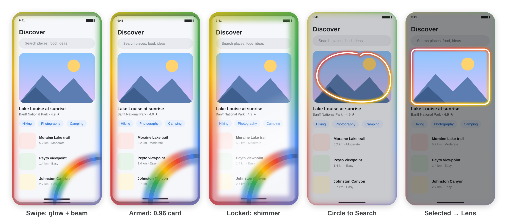
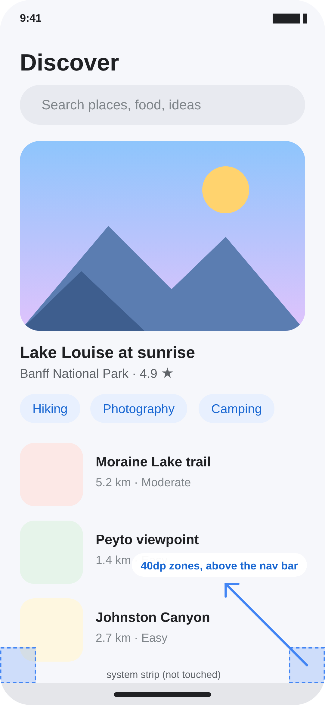
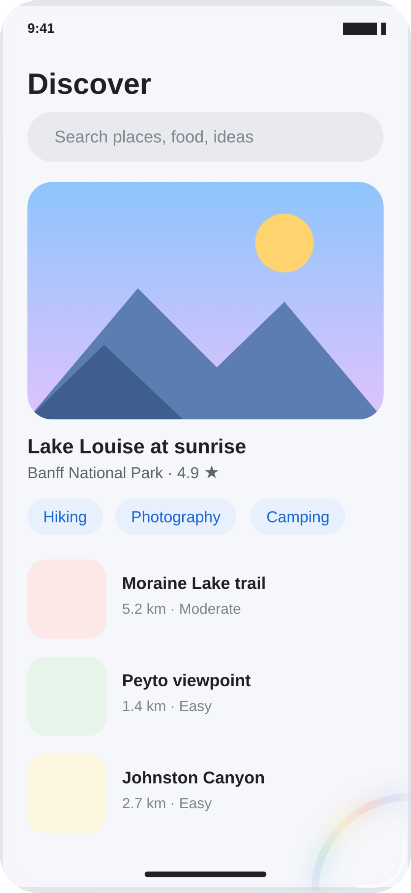
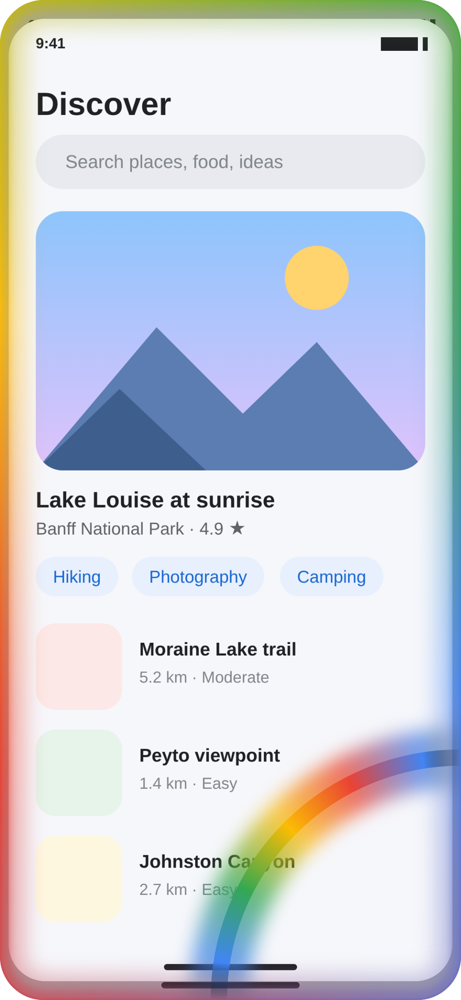
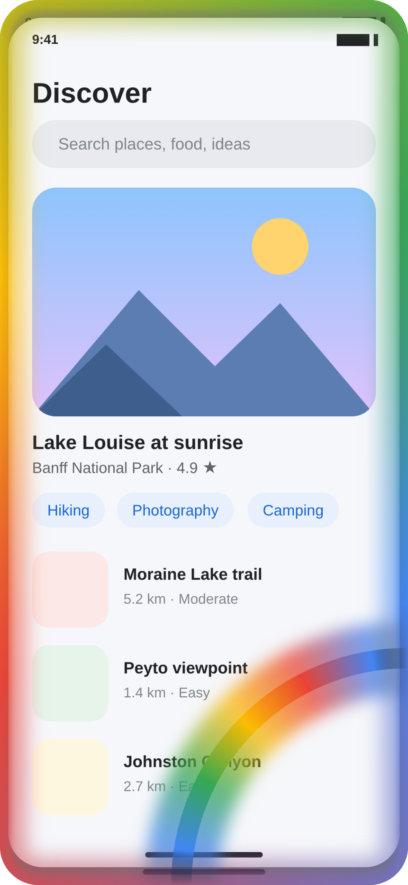
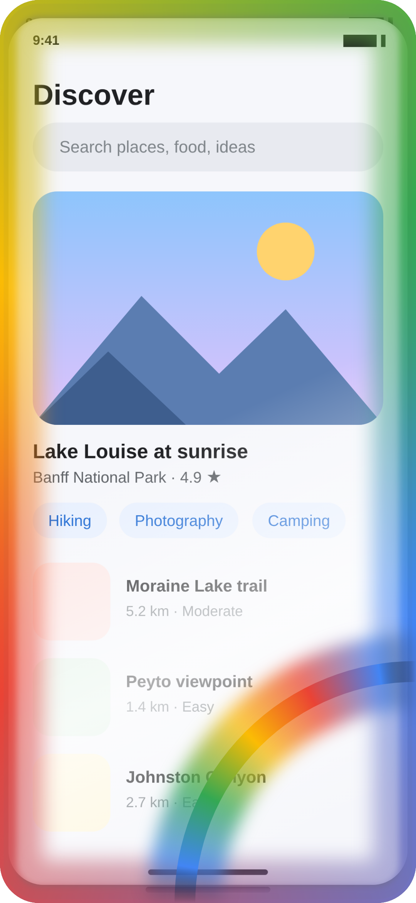
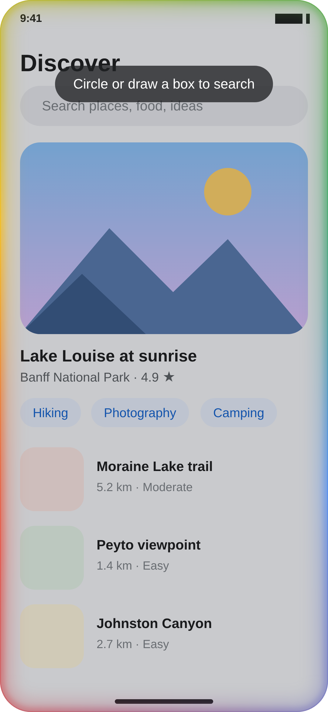
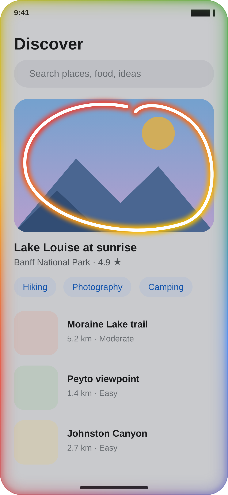
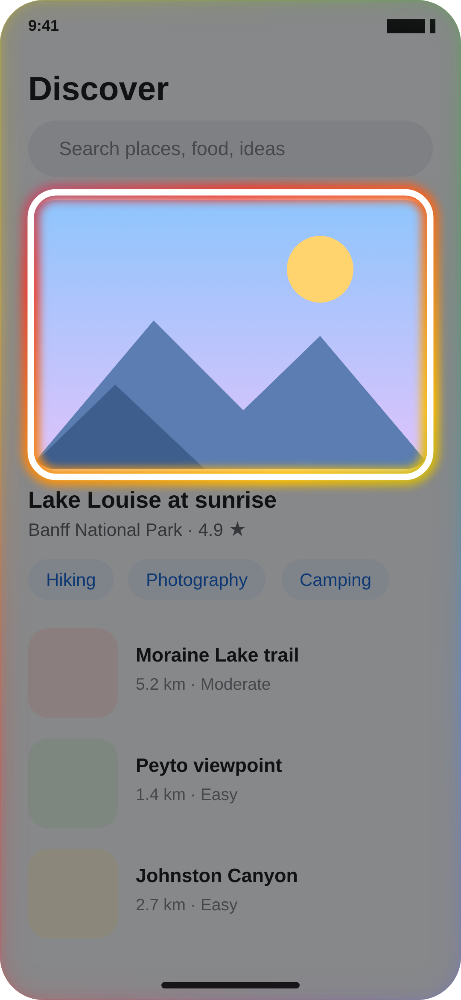

# Circlet


**Pixel-style Circle to Search for any Android 9–16 phone, powered by Shizuku: no root, no LSPosed.**

Swipe diagonally from a bottom corner and Circlet plays a Pixel-inspired animation. A multi-colour beam grows from the corner and a rainbow glow wraps the screen, and the haptics get stronger as you swipe. Then the screen freezes so you can circle anything and search it with Google Lens. On phones where Google has enabled it, Circlet can also open Google's own Circle to Search.

[**⬇ Download the latest signed APK**](https://github.com/ankitchanki/CTS/releases/latest) · Package `io.github.ankitchanki.circlet`

Forked from [parallelcc/MiCTS](https://github.com/parallelcc/micts) (GPL-3.0). Credit for the original trigger work goes to that project.



<sub>The images on this page are renders of Circlet's overlay drawing code: the same curves, sizes and colours as the app (`docs/images/ui/render.html`). They are not device screenshots, and the app in the background is a placeholder.</sub>

---

## Features

| | |
| --- | --- |
| 🌈 **Corner swipe gesture** | Swipe inward at about 45° from the bottom-left or bottom-right corner. Progress follows your finger; let go early and everything springs back. |
| ✨ **Pixel-style animation** | Corner handle lines turn into a blue/red/yellow/green crescent beam. The app shrinks to 0.96 into a rounded card, and a white shimmer flashes when the screen locks. |
| 🔆 **Edge glow** | A rotating, breathing rainbow glow around the screen edges (in the spirit of Apple Intelligence). It grows with the swipe, swells on activation and stays soft while you select. |
| 📳 **Rising haptics** | 12 ticks that get stronger as you swipe, then a crisp double-tap confirm when it activates. Uses the vibrator's haptic primitives when available. |
| ⭕ **Circle to Search mode** | Frozen screen with lasso or box selection. The selected region opens in Google Lens. |
| 🤖 **Default-assistant bridge** | Pick Circlet as *Default digital assistant app*. The phone's own assistant gestures (corner swipe, long-press power or home) then open Circle to Search mode instead of Gemini, on any brand. |
| 🛡️ **Shizuku, not root** | Screenshots, overlay permission, assistant setup and the contextual-search call go through Shizuku. No hooks, no LSPosed. |
| 🔒 **Signed releases** | Every GitHub release is signed with the project's release key, so updates install over each other. |
| 🧩 **More ways to trigger** | App icon, Quick Settings tile, or any automation app (Quick Ball, ShortX, Routines+…) that can launch an app. |

## Quick start

1. Install [Shizuku](https://shizuku.rikka.app/) and start it (wireless debugging works; root is optional).
2. Install the [latest Circlet release](https://github.com/ankitchanki/CTS/releases/latest) and open it.
3. Tap **Grant** next to *Shizuku*.
4. Pick **one** trigger. Setup by phone type is below.
   - **Use Circlet as assistant → Set** (recommended on phones without native Circle to Search), or
   - **Corner swipe gesture** on, or
   - the Quick Settings tile / app icon.

## Setup for phones without native Circle to Search

"Native" means Google has enabled Circle to Search for your model: Pixel, recent Samsung Galaxy, and some Xiaomi, Honor and OPPO phones. If long-pressing the home handle doesn't open Circle to Search on your phone, use one of these setups.

### Setup A: Circlet as the assistant (recommended, no root)

The phone's own assistant gesture opens Circlet instead of Gemini. Circlet freezes the screen, you circle something, and Google Lens searches it.

1. Start Shizuku, open Circlet and tap **Grant**.
2. In Circlet, tap **Use Circlet as assistant → Set**. With Shizuku this happens instantly. Without it, the *Default apps* screen opens; choose **Digital assistant app → Circlet**.
3. In that same *Digital assistant app* screen, keep **Use screenshot** on if your phone shows it. Circlet uses the system's screenshot on this path.
4. Turn on your phone's assistant gesture. Menu names differ by brand:
   - **Xiaomi / Redmi / POCO (HyperOS, MIUI):** *Settings → Additional settings → Gesture shortcuts → Launch assistant*, or the "swipe up from a bottom corner" option under full-screen gestures. You can also use long-press power → assistant.
   - **Samsung (One UI):** with swipe gestures on, the "swipe from bottom corner" assistant option under *Navigation bar → More options*; or set the side key to open the assistant.
   - **Pixel / stock Android:** *Settings → System → Gestures → Navigation mode → (gear) → Swipe to invoke assistant*.
   - **Others:** look for "assistant", "voice assistant" or "swipe from corner" in gesture or button settings. Long-press power or home → assistant works almost everywhere.
5. Swipe from the corner (or long-press). You should see the glow and shimmer, then *Circle or draw a box to search*.

Trade-off: while Circlet is the assistant, Google Assistant and Gemini aren't. Google's own Circle to Search UI can't be opened without root in this mode, so Circlet uses its own lasso with Google Lens results.

### Setup B: Circlet's own corner gesture (keeps Gemini as assistant)

1. Start Shizuku, open Circlet and tap **Grant**.
2. Turn on **Corner swipe gesture**. *Display over other apps* is granted through Shizuku.
3. Keep **Gesture action → Built-in lasso**.
4. Keep **Stop Gemini on corner swipe** on. It turns off Android's own corner-assistant gesture (AOSP/Pixel setting), so it doesn't race Circlet.
5. Swipe from just above the navigation bar in a bottom corner, inward at about 45°.



The touch zones sit just **above** the navigation bar or gesture strip. That strip belongs to the system: touches there go to Recents, Home or Back, not to apps. If your launcher still claims the swipe, use Setup A.

### Setup C: Google's real Circle to Search on an unsupported phone (root)

Google decides on its servers whether Circle to Search is enabled for a model; no app can change that without root. With root:

1. Set **Google** as the default assistant (Circlet: **Set Google as default assistant**).
2. Use GMS Flags or similar to enable Google's Circle to Search flags for your device (see the MiCTS project's notes), or a root device-spoof module.
3. In Circlet, set **System trigger service → VIS** (or **CSService** on Android 15+ with Shizuku running as root), and **Gesture action → System Circle to Search**.

If Gemini opens instead of Circle to Search, Google hasn't enabled it for your device; use Setup A.

## How it looks

| Swipe starts | Swipe at 60% | Armed (100%) | Screen locked |
| :---: | :---: | :---: | :---: |
|  |  |  |  |
| Handle lines turn into the beam | Glow and card recess follow your finger | 0.96 rounded card, full glow, haptic confirm | White shimmer while the glow swells |

| Circle to Search mode | Drawing a lasso | Selection sent to Lens |
| :---: | :---: | :---: |
|  |  |  |
| Frozen screen with a soft glow | Pixel-gradient glow under a white stroke | Outside dimmed, then Google Lens opens |

## Settings reference

- **Shizuku**: connection status, with a button to grant or open Shizuku.
- **System trigger service**
  - `VIS`: works without Shizuku when Google is the default assistant.
  - `CSService`: Android 15+. Needs Shizuku **started with root**, because the shell user lacks `ACCESS_CONTEXTUAL_SEARCH`, and a phone whose system has the contextual search service. Falls back to `VIS` otherwise.
- **Use Circlet as assistant**: makes Circlet the default digital assistant (Setup A).
- **Set Google as default assistant**: switches back to Google, needed for `VIS` / Setup C.
- **Corner swipe gesture**: Circlet's own corner zones (Setup B).
- **Stop Gemini on corner swipe**: turns off Android's corner-assistant gesture while Circlet's gesture is on, and restores your setting when you turn it off. It steps aside while Circlet itself is the assistant.
- **Gesture action**: `Built-in lasso` (frozen screen → Lens) or `System Circle to Search` (Google's UI through the trigger service).
- **App settings**: launch and tile delays, vibration, async trigger, language.

## Troubleshooting

| Problem | Fix |
| --- | --- |
| Touching a corner opens Recents | Fixed in v1.3.0: zones moved above the navigation bar. Update, and start the swipe slightly above the bar. |
| Corner swipe opens Gemini | Use Setup A (Circlet as assistant). Or, for Setup B, keep *Stop Gemini on corner swipe* on; OEM launchers with their own setting need it turned off by hand. |
| "Circlet didn't get the screen" | Turn on *Use screenshot* in *Digital assistant app* settings, or grant Shizuku in Circlet. |
| "Circle to Search mode needs Shizuku" | Start Shizuku and tap **Grant** in Circlet. The built-in lasso needs it for screenshots on the corner-gesture path. |
| Nothing happens with Circlet as assistant | Reinstalling clears the assistant choice; pick Circlet again. Check that your phone's assistant gesture is on (Setup A, step 4). |
| Voice input says unavailable in some apps | While Circlet is the assistant, Android points the system speech recognizer at it. Gboard has its own and keeps working; switch the assistant back to Google if another app needs it. |
| Update won't install over the old version | Builds before signed releases used a temporary key. Uninstall once, then install the signed release; later updates install normally. |

## How it works

```
gesture/CornerVectorMath.kt      pure vector math: corner zones (above the nav bar), 45° direction, linear progress
gesture/CornerGestureTracker.kt  pure state machine: Idle → Tracking → Activated / Cancelled
gesture/GestureVisuals.kt        pure curves: progress/time → card scale, beam, glow, shimmer
gesture/HapticSteps.kt           pure rising-detent logic for haptics
gesture/SelectionGeometry.kt     pure lasso → bounding box → bitmap pixels
gesture/GestureHaptics           vibration primitives with fallbacks
gesture/CornerGestureController  glue: touches → tracker → visuals → overlay windows, screenshot, hand-off
overlay/EffectsView              recessed card, corner beam, shimmer
overlay/EdgeGlowRenderer         rotating, breathing edge glow
overlay/SelectionOverlayView     Circle to Search mode: frozen frame + lasso
assist/CircletVoiceInteractionService, CircletSession, InvocationSequence
                                 default-assistant bridge: system screenshot → animation → lasso → Lens
shizuku/ShellService, ShizukuManager
                                 privileged calls (screencap, settings, roles, contextual search) as shell/root
```

The pure parts are unit tested: `./gradlew :app:testDebugUnitTest`.

Known limitations:
- Overlays are drawn below the status and navigation bars, so the real bars stay on top of the recessed card.
- Google's own Circle to Search UI only opens when Google is the default assistant and has the feature enabled for your phone.

## Design assets

The app icon, UI glyphs and overlay artwork each have a separate SVG in [`design/svg`](design/README.md). The README renders come from [`docs/images/ui/render.html`](docs/images/ui/render.html).

## Building and releasing

- Every push builds and unit-tests a release APK in GitHub Actions (artifact `Circlet_<commit>`).
- To publish a release, run **Actions › CI Build › Run workflow** with a tag such as `v1.3.1`. The workflow creates the tag and publishes a GitHub Release with the APK.
- Releases are signed with the keystore stored in the repository secrets `KEY_STORE`, `KEY_STORE_PASSWORD`, `ALIAS` and `KEY_PASSWORD`. A local build without them is signed with the debug key.

## License

GPL-3.0, same as upstream. See [LICENSE](LICENSE).
